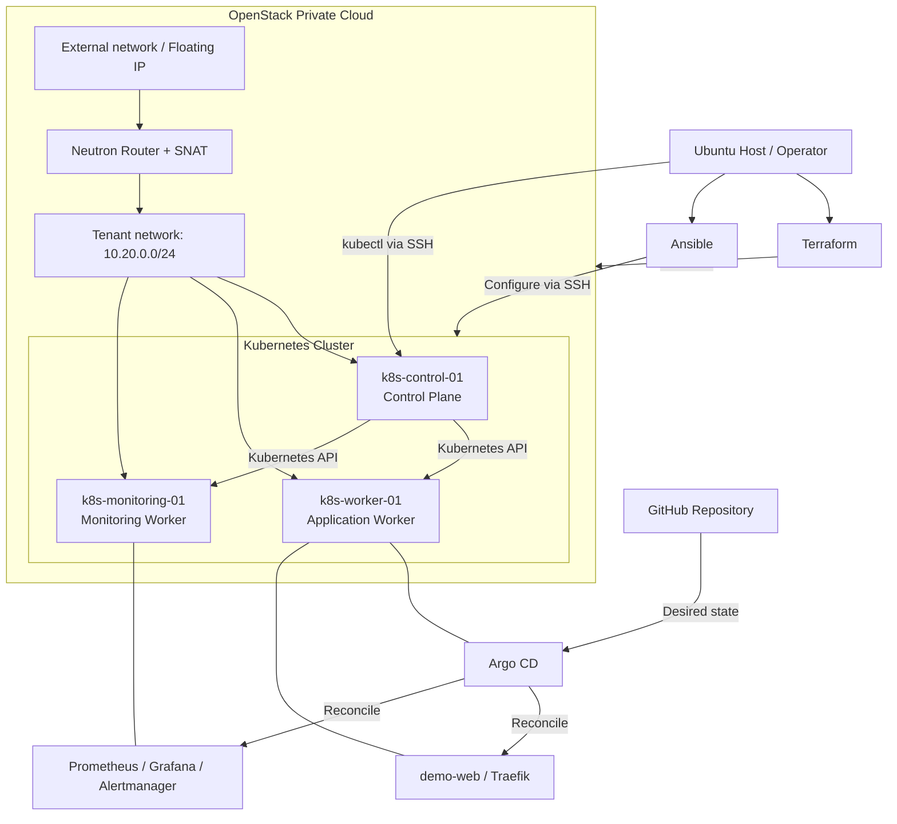

# OpenStack Cloud-Native Private Infrastructure Lab

> **Infrastructure as Code · Kubernetes · GitOps · Observability · SRE**
>
> Dự án thực hành xây dựng và vận hành một nền tảng Kubernetes trên **OpenStack Private Cloud**, từ cấp phát tài nguyên đến triển khai ứng dụng, giám sát và xử lý sự cố.

**Repository:** [hoang4325/Openstack-Cloud-Native-Private](https://github.com/hoang4325/Openstack-Cloud-Native-Private)  
**Environment:** Lab / Non-production  
**Default branch:** `master`

## Mục lục

- [1. Tổng quan](#1-tổng-quan)
- [2. Kiến trúc](#2-kiến-trúc)
- [3. Cấu trúc repository](#3-cấu-trúc-repository)
- [4. Yêu cầu chuẩn bị](#4-yêu-cầu-chuẩn-bị)
- [5. Hướng dẫn triển khai](#5-hướng-dẫn-triển-khai)
- [6. Giám sát và truy cập](#6-giám-sát-và-truy-cập)
- [7. Kiểm tra và vận hành](#7-kiểm-tra-và-vận-hành)
- [8. Troubleshooting và SRE](#8-kubernetes-troubleshooting-và-sre-dự-kiến-tích-hợp)
- [9. Bảo mật](#9-bảo-mật-và-an-toàn-cấu-hình)
- [10. Lộ trình phát triển](#10-lộ-trình-phát-triển)

## 1. Tổng quan

Dự án áp dụng quy trình triển khai nhiều lớp:

1. **Terraform** cấp phát tài nguyên OpenStack: network, subnet, router, security group, floating IP và máy ảo.
2. **Ansible** chuẩn bị Ubuntu VM, cài containerd, Kubernetes bằng kubeadm, Calico, Helm, Argo CD và Traefik.
3. **Helm + Argo CD** quản lý triển khai ứng dụng mẫu và hệ thống monitoring theo mô hình GitOps.
4. **Prometheus, Grafana và Alertmanager** cung cấp metrics, dashboard và nền tảng cảnh báo.
5. **Troubleshooting / SRE** là hướng mở rộng tiếp theo: fault injection có kiểm soát, điều tra sự cố, runbook và RCA.

**Phạm vi:** Repository hiện quản lý tài nguyên **bên trong một OpenStack cloud đã hoạt động**. Mã cài đặt OpenStack bằng Kolla-Ansible **chưa nằm trong repo này**; bước chuẩn bị nền tảng OpenStack là điều kiện đầu vào.

### Công nghệ sử dụng

| Layer | Công nghệ / phiên bản thể hiện trong source |
| --- | --- |
| Private cloud | OpenStack (cloud profile mặc định: `kolla-admin`) |
| Infrastructure as Code | Terraform `>= 1.5.0`, OpenStack provider `3.4.0` |
| OS / VM | Ubuntu Server 24.04 |
| Configuration management | Ansible |
| Container runtime | containerd |
| Container orchestration | Kubernetes qua kubeadm; control plane khởi tạo `v1.36.5` |
| Networking / CNI | Calico `v3.33.0`, VXLAN |
| Package management | Helm (`v4.3.0` theo playbook) |
| Ingress | Traefik Helm chart `39.0.7` |
| GitOps | Argo CD Helm chart `10.9.6` |
| Observability | kube-prometheus-stack chart `91.8.1` |

> Các phiên bản ở trên là cấu hình **được khai báo trong repository**, không phải kết quả kiểm tra trạng thái runtime tại thời điểm đọc README. Khi nâng cấp, cần kiểm tra tính tương thích giữa các thành phần.

## 2. Kiến trúc



### Cấu hình các node

| Node | Vai trò | Cấu hình khai báo | IP cố định mặc định |
| --- | --- | --- | --- |
| `k8s-control-01` | Control plane | 2 vCPU / 4 GiB RAM | `10.20.0.10` |
| `k8s-worker-01` | Worker ứng dụng; Argo CD; Traefik; demo-web | 2 vCPU / 2 GiB RAM | `10.20.0.11` |
| `k8s-monitoring-01` | Worker dành cho monitoring | 4 vCPU / 4 GiB RAM | `10.20.0.12` |

### Thiết kế mạng

| Network | Giá trị ví dụ / mặc định | Ghi chú |
| --- | --- | --- |
| External network | `172.30.0.0/24` | Thay theo môi trường OpenStack thực tế |
| Tenant network | `10.20.0.0/24` | Kết nối các Kubernetes nodes |
| Pod CIDR | `192.168.0.0/16` | Calico VXLAN |
| Service CIDR | `10.96.0.0/12` | Cấu hình kubeadm |
| Traefik HTTP | NodePort `30080` | Security group hiện giới hạn nguồn tới `172.30.0.1/32`; cần kiểm tra tuyến truy cập thực tế |
| SSH | TCP `22` | Giới hạn bằng `ssh_allowed_cidr` |

Cụm này được thiết kế cho **lab, không phải kiến trúc HA production**: một control plane, một bản sao nhiều thành phần và giới hạn về tài nguyên/lưu trữ.

## 3. Cấu trúc repository

Cấu trúc **đã có trên nhánh `master`** khi README được cập nhật:

```text
Openstack-Cloud-Native-Private/
├── ansible/
│   ├── inventory/hosts.ini           # Ansible inventory
│   ├── manifests/                     # Kiểm tra kết nối mạng
│   └── playbooks/                     # Kubernetes, Calico, Helm, Argo CD, Traefik
├── terraform/
│   ├── openstack/                     # Foundation: image, external network, keypair, flavors
│   └── k8s-cluster/                   # Tenant network, security groups, 3 VM, floating IP
├── kubernetes/
│   └── apps/demo-web/                 # Demo application manifests
├── helm/
│   ├── argocd/                        # Argo CD values
│   ├── traefik/                       # Traefik values
│   └── monitoring/                    # kube-prometheus-stack values
└── gitops/
    └── applications/
        ├── demo-web.yaml
        └── monitoring.yaml
```

**Cấu trúc dự kiến bổ sung (chưa có trên `master`):**

```text
labs/kubernetes/troubleshooting/
├── student-blind-labs/              # Lab điều tra, không cung cấp lời giải sẵn
└── operator-fault-injector/         # Tạo/reset sự cố có kiểm soát
sre/
├── incidents/                       # RCA theo từng incident
├── runbooks/                        # Hướng dẫn xử lý lỗi tái sử dụng
├── alert-rules/                     # Custom PrometheusRule
└── slo/                             # SLI/SLO definitions
docs/
├── architecture/
├── deployment/
├── operations/
└── adr/                              # Architecture Decision Records
tests/                                # Validation / smoke / recovery tests
.github/workflows/                    # CI quality gates
README.md                             # Tài liệu tổng quan này
```

> Chỉ bổ sung đường dẫn/link tới lab và RCA sau khi các thư mục này đã được commit. Không cấu hình Argo CD tự động đồng bộ các manifest **fault injection** vào cluster.

## 4. Yêu cầu chuẩn bị

Trên **Ubuntu Host / máy chạy automation**, cần có:

- OpenStack cloud hoạt động và account đủ quyền tạo network, router, port, floating IP, image, keypair, flavor và VM.
- `clouds.yaml` có profile `kolla-admin` (hoặc chỉnh `cloud_name` trong Terraform cho phù hợp).
- Terraform `>= 1.5.0`, Ansible, Python 3, SSH client; OpenStack CLI là công cụ kiểm tra tùy chọn.
- SSH keypair: ví dụ `~/.ssh/id_ed25519` và `~/.ssh/id_ed25519.pub`.
- Kết nối tới OpenStack API, các IP quản trị VM và các nguồn tải container images/packages.
- Đủ compute, memory, network và quota OpenStack cho ba VM.

Kiểm tra OpenStack credential nếu đã cài OpenStack CLI:

```bash
openstack --os-cloud kolla-admin token issue
```

**Mọi lệnh Terraform/Ansible bên dưới chạy từ thư mục gốc repository**, trừ khi có ghi chú khác.

## 5. Hướng dẫn triển khai

### Bước 1 — Tạo tài nguyên nền tảng OpenStack

```bash
cp terraform/openstack/terraform.tfvars.example \
   terraform/openstack/terraform.tfvars
```

Chỉnh `terraform/openstack/terraform.tfvars` cho đúng môi trường: `cloud_name`, `region`, external network/CIDR/gateway, allocation pool, physical network, SSH public key và các flavor.

```bash
terraform -chdir=terraform/openstack init
terraform -chdir=terraform/openstack validate
terraform -chdir=terraform/openstack plan
terraform -chdir=terraform/openstack apply
```

Mặc định ví dụ sử dụng external network `172.30.0.0/24`, gateway `172.30.0.1`, physical network `physnet1`. Đây **không** phải giá trị dùng chung cho mọi hệ thống.

### Bước 2 — Tạo các VM Kubernetes

```bash
cp terraform/k8s-cluster/terraform.tfvars.example \
   terraform/k8s-cluster/terraform.tfvars
```

Chỉnh `cloud_name`, `region`, địa chỉ IP cố định và đặc biệt `ssh_allowed_cidr` theo mạng quản trị thực tế; không mở SSH cho toàn Internet.

```bash
terraform -chdir=terraform/k8s-cluster init
terraform -chdir=terraform/k8s-cluster validate
terraform -chdir=terraform/k8s-cluster plan
terraform -chdir=terraform/k8s-cluster apply
terraform -chdir=terraform/k8s-cluster output
```

Lưu lại floating IP của control plane trên **Ubuntu Host**:

```bash
CONTROL_FLOATING_IP="$(terraform -chdir=terraform/k8s-cluster output -raw control_floating_ip)"
printf 'Control plane: %s\n' "$CONTROL_FLOATING_IP"
```

Cập nhật `ansible/inventory/hosts.ini` bằng floating IP thực tế của ba VM. Biến `node_ip` trong inventory phải khớp với tenant IP của node.

> **Terraform state:** Module `terraform/k8s-cluster` hiện đọc local state từ `../openstack/terraform.tfstate`. Không xóa hoặc di chuyển file state một cách thủ công khi đang sử dụng hạ tầng. Cần backup và thiết kế migration trước khi chuyển sang remote backend.

### Bước 3 — Cài Kubernetes bằng Ansible

Kiểm tra SSH qua Ansible:

```bash
ansible -i ansible/inventory/hosts.ini k8s_cluster -m ping
```

Chạy lần lượt các playbook:

```bash
ansible-playbook -i ansible/inventory/hosts.ini ansible/playbooks/prepare-nodes.yml
ansible-playbook -i ansible/inventory/hosts.ini ansible/playbooks/install-kubernetes.yml
ansible-playbook -i ansible/inventory/hosts.ini ansible/playbooks/init-control-plane.yml
ansible-playbook -i ansible/inventory/hosts.ini ansible/playbooks/install-calico.yml
ansible-playbook -i ansible/inventory/hosts.ini ansible/playbooks/join-workers.yml
```

Xác minh Kubernetes control plane và worker nodes:

```bash
ssh "ubuntu@${CONTROL_FLOATING_IP}" 'kubectl get nodes -o wide'
```

Cụm hoàn thành bước này khi cả ba node có thể chuyển sang trạng thái `Ready`. Nếu chưa đạt, kiểm tra kubelet, containerd, CNI và network security rules.

### Bước 4 — Cài Helm, Argo CD và Traefik

```bash
ansible-playbook -i ansible/inventory/hosts.ini ansible/playbooks/install-helm.yml
ansible-playbook -i ansible/inventory/hosts.ini ansible/playbooks/install-argocd.yml
ansible-playbook -i ansible/inventory/hosts.ini ansible/playbooks/install-traefik.yml
```

Theo cấu hình hiện tại, Argo CD và Traefik được đặt trên `k8s-worker-01`. Argo CD cài bằng Helm; Traefik mở HTTP NodePort `30080` và đăng ký IngressClass `traefik`.

Để kiểm tra Argo CD:

```bash
ssh "ubuntu@${CONTROL_FLOATING_IP}" 'kubectl get pods -n argocd'
```

Mật khẩu admin ban đầu (nếu Secret chưa bị xóa hoặc được thay thế sau khi đổi mật khẩu) nằm trong `argocd-initial-admin-secret`. Không ghi hoặc chia sẻ mật khẩu trên GitHub.

### Bước 5 — Triển khai Monitoring và demo-web bằng GitOps

Đăng nhập control plane từ Ubuntu Host:

```bash
ssh "ubuntu@${CONTROL_FLOATING_IP}"
```

Trên **control plane**, gán nhãn node và tạo Secret cho Grafana:

```bash
kubectl label node k8s-monitoring-01 workload=monitoring --overwrite
kubectl create namespace monitoring --dry-run=client -o yaml | kubectl apply -f -

read -rsp 'Grafana admin password: ' GRAFANA_ADMIN_PASSWORD
printf '\n'
kubectl -n monitoring create secret generic monitoring-grafana-admin \
  --from-literal=admin-user=admin \
  --from-literal=admin-password="$GRAFANA_ADMIN_PASSWORD"
unset GRAFANA_ADMIN_PASSWORD
```

Nếu Secret đã tồn tại, **không chạy lại lệnh tạo Secret**; quản lý thay đổi credential bằng quy trình riêng. File `helm/monitoring/values.yaml` tham chiếu Secret này.

Bootstrap Prometheus Operator CRDs tương ứng với chart trước khi tạo Argo CD Application, vì Application hiện đặt `skipCrds: true`:

```bash
helm repo add prometheus-community https://prometheus-community.github.io/helm-charts
helm repo update
helm show crds prometheus-community/kube-prometheus-stack --version 91.8.1 \
  | kubectl apply --server-side --field-manager=monitoring-crd-bootstrap -f -
exit
```

Trở lại **Ubuntu Host**, chép và áp dụng hai Argo CD Application:

```bash
scp gitops/applications/monitoring.yaml "ubuntu@${CONTROL_FLOATING_IP}:/tmp/monitoring-application.yaml"
scp gitops/applications/demo-web.yaml "ubuntu@${CONTROL_FLOATING_IP}:/tmp/demo-web-application.yaml"

ssh "ubuntu@${CONTROL_FLOATING_IP}" 'kubectl apply -f /tmp/monitoring-application.yaml'
ssh "ubuntu@${CONTROL_FLOATING_IP}" 'kubectl apply -f /tmp/demo-web-application.yaml'
```

Argo CD đọc desired state từ nhánh `master`. Hai Application khai báo `automated.enabled: true`, `selfHeal: true`, nhưng `prune: false` — tài nguyên bị xóa khỏi Git **không tự động bị prune**.

Kiểm tra trạng thái:

```bash
ssh "ubuntu@${CONTROL_FLOATING_IP}" 'kubectl get applications -n argocd'
ssh "ubuntu@${CONTROL_FLOATING_IP}" 'kubectl get pods -n monitoring -o wide'
ssh "ubuntu@${CONTROL_FLOATING_IP}" 'kubectl get pods -n demo -o wide'
```

Thử truy cập demo-web từ control plane (trong tenant network):

```bash
ssh "ubuntu@${CONTROL_FLOATING_IP}" \
  'curl -H "Host: demo.lab.test" http://10.20.0.11:30080'
```

Demo được khai báo qua Ingress host `demo.lab.test`; lệnh `curl` gắn `Host` header để kiểm tra định tuyến mà không cần cấu hình DNS bên ngoài.

## 6. Giám sát và truy cập

### Grafana

Trên **Ubuntu Host**, mở SSH tunnel và giữ phiên này đang chạy:

```bash
ssh -L 3000:127.0.0.1:3000 "ubuntu@${CONTROL_FLOATING_IP}" \
  'kubectl -n monitoring port-forward svc/monitoring-grafana 3000:80'
```

Mở [http://localhost:3000](http://localhost:3000). Tài khoản/credential được lưu trong Secret `monitoring-grafana-admin`. Chỉ đọc mật khẩu khi cần thiết và tránh ghi lại vào lịch sử lệnh, screenshot hoặc tài liệu công khai.

### Prometheus

Trong terminal khác:

```bash
ssh -L 9090:127.0.0.1:9090 "ubuntu@${CONTROL_FLOATING_IP}" \
  'kubectl -n monitoring port-forward svc/monitoring-kube-prometheus-prometheus 9090:9090'
```

Mở [http://localhost:9090/targets](http://localhost:9090/targets) để kiểm tra các scrape targets và trạng thái `UP`/`DOWN`.

### Giới hạn hiện tại

- Prometheus được cấu hình retention **3 ngày** và `retentionSize: 3GiB`.
- `storageSpec: {}` chưa cung cấp PVC cho Prometheus; `grafana.persistence.enabled: false`. Không xem đây là nơi lưu metrics/dashboard bền vững.
- Alertmanager và default rules đã bật nhưng **chưa có receiver thông báo tùy chỉnh** được khai báo trong repo.
- Các endpoint etcd, kube-controller-manager, kube-scheduler, kube-proxy hiện được tắt giám sát trong cấu hình chart. Cần cấu hình endpoint và quyền truy cập trước khi mở lại.
- Các thành phần chủ yếu chạy single-replica, không phải high availability.

## 7. Kiểm tra và vận hành

Kiểm tra nhanh:

```bash
ssh "ubuntu@${CONTROL_FLOATING_IP}" 'kubectl get nodes'
ssh "ubuntu@${CONTROL_FLOATING_IP}" 'kubectl get applications -n argocd'
ssh "ubuntu@${CONTROL_FLOATING_IP}" 'kubectl get pods -n monitoring -o wide'
ssh "ubuntu@${CONTROL_FLOATING_IP}" 'kubectl get prometheus,alertmanager -n monitoring'
```

Sau khi sửa playbook, chỉ chạy lại **playbook có liên quan**:

```bash
ansible-playbook -i ansible/inventory/hosts.ini ansible/playbooks/PLAYBOOK_NAME.yml
```

Đối với GitOps, commit thay đổi lên repository sau khi review rồi theo dõi Argo CD reconcile:

```bash
ssh "ubuntu@${CONTROL_FLOATING_IP}" \
  'kubectl get applications -n argocd -o wide'
```

Nếu cần ép một lần đồng bộ thủ công, thực hiện trên Argo CD UI hoặc `argocd app sync <APP_NAME>` sau khi đã cài và đăng nhập Argo CD CLI. Không cần tự patch trực tiếp trường `operation` vào Application trong quy trình thông thường.

## 8. Kubernetes Troubleshooting và SRE (dự kiến tích hợp)

Hai bộ lab đang được thực hành độc lập sẽ được đưa vào `labs/kubernetes/troubleshooting/` sau khi rà soát nội dung và quyền thực thi:

| Thành phần | Mục đích |
| --- | --- |
| `student-blind-labs/` | Bài thực hành phát hiện và điều tra lỗi, không lộ lời giải từ đầu |
| `operator-fault-injector/` | Chủ động tạo/reset lỗi **chỉ trong namespace lab** với kiểm tra context và xác nhận trước khi thực thi |
| `sre/runbooks/` | Hướng dẫn xử lý từng nhóm lỗi có thể tái sử dụng |
| `sre/incidents/` | Báo cáo RCA của từng lần xảy ra sự cố |

Một số tình huống thực hành: `ImagePullBackOff`, `CreateContainerConfigError`, Pod `Pending`, `CrashLoopBackOff`, readiness failure và lỗi định tuyến Service. Danh sách chính thức phải khớp với những scenario thực sự có trong bộ lab khi import.

### Quy trình xử lý sự cố

```text
Fault Injection (lab only)
    -> Detection
    -> Triage / Evidence Collection
    -> Root Cause Verification
    -> Recovery
    -> Validation
    -> RCA / Preventive Actions
```

Ví dụ, **sau khi** bộ lab đã được copy lên control plane:

```bash
cd ~/student-blind-labs
mkdir -p ~/rca-evidence/INC-001

# triage.sh chỉ in kết quả lên terminal; tee giúp lưu evidence.
./triage.sh snapshot 2>&1 | tee ~/rca-evidence/INC-001/snapshot.txt

# Chỉ chạy nếu Pod tình huống này đang tồn tại.
kubectl describe pod inc01-obj01 -n troubleshooting-lab \
  > ~/rca-evidence/INC-001/pod-describe.txt 2>&1
kubectl get events -n troubleshooting-lab --sort-by=.lastTimestamp \
  > ~/rca-evidence/INC-001/events.txt
```

**Lưu ý:** `triage.sh snapshot` **không tạo VM snapshot hoặc backup Kubernetes**; trong phiên bản script đang sử dụng, nó đọc Kubernetes context, liệt kê resources và hiển thị 40 dòng Events cuối. Thu thập bằng chứng trước khi sửa lỗi; loại bỏ IP/credential/dữ liệu nhạy cảm trước khi đưa evidence lên GitHub.

RCA cần có **Incident Summary, Impact, Detection, Timeline, Evidence, Root Cause, Recovery Verification và Preventive Actions**. Không suy luận lỗi CI/CD pipeline hoặc tác động đến production nếu không có chứng cứ. Tách biệt runbook tổng quát và RCA của một incident cụ thể.

## 9. Bảo mật và an toàn cấu hình

- **Repository hiện public**: kiểm tra kỹ thông tin trong inventory, log, screenshot và RCA trước khi commit.
- Không commit `clouds.yaml`, `terraform.tfvars`, Terraform state/plan, `.env`, kubeconfig, SSH private key hoặc Secret/credential.
- Backup Terraform state, đặc biệt khi đang dùng local backend và phụ thuộc `terraform_remote_state`.
- Luôn xem kết quả `terraform plan` trước khi `apply`; thay network hoặc flavor có thể tạo lại VM.
- Giới hạn `ssh_allowed_cidr` và NodePort access theo mạng quản trị đáng tin cậy; kiểm tra cả OpenStack security groups và firewall.
- Không tự động chạy fault injector trên production cluster. Dùng namespace, RBAC, context allowlist và bước xác nhận.
- Bảo vệ nhánh GitOps, review thay đổi và kiểm thử manifest trước khi merge vào `master`.
- Các câu lệnh ở README là quy trình lab; khi áp dụng cho môi trường thật cần bổ sung backup, HA, quản lý secrets và change control.

## 10. Lộ trình phát triển

| Phase | Hạng mục | Trạng thái theo repository |
| --- | --- | --- |
| 1 | OpenStack resources bằng Terraform | Đã có source |
| 2 | Bootstrap Kubernetes + Calico bằng Ansible | Đã có source |
| 3 | Helm, Traefik, Argo CD, demo-web | Đã có source |
| 4 | Prometheus, Grafana, Alertmanager | Đã có source; còn hạn chế storage/alert routing |
| 5 | Kubernetes Troubleshooting Labs, fault injection, runbooks và RCA | **Dự kiến tích hợp** |
| 6 | CI validation: `terraform fmt/validate`, `ansible-lint`, Helm/Kubernetes manifest checks | **Dự kiến** |
| 7 | Log aggregation, custom alerts, SLI/SLO, incident dashboards | **Dự kiến** |
| 8 | Backup/restore, persistent volumes, disaster recovery và chaos testing có kiểm soát | **Dự kiến** |

**Mục tiêu cuối:** `Provision → Configure → Deploy → Observe → Detect → Troubleshoot → Recover → RCA → Prevent Recurrence`.

---

> **Ghi chú về tài liệu:** README này mô tả cấu hình từ mã nguồn và quy trình triển khai dự kiến. Để xác nhận trạng thái hệ thống đang chạy, luôn đối chiếu với Terraform outputs, Ansible execution logs, Argo CD Application status và kết quả `kubectl` thực tế.
