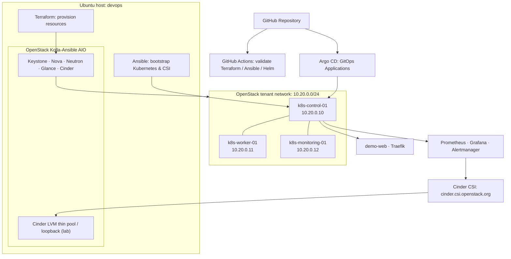
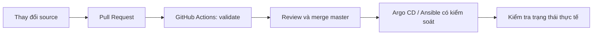

# OpenStack Cloud-Native Private Infrastructure Lab

> **OpenStack · Terraform · Ansible · Kubernetes · Cinder CSI · Argo CD · Prometheus / Grafana / Alertmanager**

Repository: [hoang4325/Openstack-Cloud-Native-Private](https://github.com/hoang4325/Openstack-Cloud-Native-Private)
Môi trường: **Private Cloud Lab** — một host OpenStack All-in-One và cụm Kubernetes 3 node chạy trên các máy ảo OpenStack.

Tài liệu này tập trung vào **kiến trúc hệ thống hiện tại** và **trình tự dựng lại hạ tầng trên một môi trường mới** theo đúng cấu hình được quản lý trong repository. Đây không phải hướng dẫn nâng cấp hay reset hệ thống đang hoạt động.

## 1. Kiến trúc tổng thể



### Các lớp hạ tầng

| Lớp | Công nghệ | Vai trò |
|---|---|---|
| Private cloud | OpenStack Kolla-Ansible AIO | Cung cấp API, compute, network, image và block storage |
| Provisioning | Terraform / OpenStack provider | Tạo image, flavor, keypair, networks, router, security groups, ports, floating IP và 3 VM |
| OS & Kubernetes | Ansible, Ubuntu 24.04, containerd, kubeadm | Chuẩn bị node, cài Kubernetes và gia nhập worker |
| Container networking | Calico VXLAN | Kết nối các Pod trên các node |
| Ingress | Traefik | Nhận HTTP qua NodePort `30080` và định tuyến đến ứng dụng demo |
| GitOps | Helm, Argo CD | Quản lý desired state của demo-web, Monitoring và StorageClass |
| Persistent storage | OpenStack Cinder CSI, `cinder-lvm` | Dynamic provisioning, attach và mount volume cho Kubernetes PVC |
| Observability | kube-prometheus-stack | Metrics, dashboard và alert management |
| CI | GitHub Actions | Validate Terraform, Ansible và Helm, không tự triển khai vào cluster |

### Node và network

| VM | Vai trò | Fixed IP | Floating IP trong lab hiện tại |
|---|---|---|---|
| `k8s-control-01` | Kubernetes control plane | `10.20.0.10` | `172.30.0.114` |
| `k8s-worker-01` | Application worker, Argo CD, Traefik | `10.20.0.11` | `172.30.0.112` |
| `k8s-monitoring-01` | Monitoring worker | `10.20.0.12` | `172.30.0.105` |

- Provider/external network mẫu: `172.30.0.0/24`; tenant network: `10.20.0.0/24`.
- Pod CIDR: `192.168.0.0/16`; Service CIDR: `10.96.0.0/12`.
- SSH dùng floating IP, được giới hạn theo `ssh_allowed_cidr` và các rule Neutron.
- Floating IP có thể **khác** khi triển khai lại; luôn lấy giá trị từ Terraform output thay vì sao chép IP của lab hiện tại.
- Một control plane, một replica cho nhiều dịch vụ và một OpenStack AIO: **đây không phải kiến trúc HA / production**.

### Persistent storage hiện tại

| Workload | StorageClass | PVC | Kiểm chứng trong lab |
|---|---|---|---|
| Grafana | `cinder-lvm` | `3Gi` | Dashboard còn sau khi tạo lại Pod |
| Alertmanager | `cinder-lvm` | `2Gi` | Silence thử nghiệm còn sau khi tạo lại Pod |
| Prometheus | `cinder-lvm` | `10Gi` | 11 samples lịch sử khớp trước/sau restart |

Các volume được cấp phát bằng CSI từ Cinder backend trên OpenStack host. LVM thin pool file-backed của lab sử dụng một file loopback khoảng `30GiB`; **dữ liệu vẫn phụ thuộc host OpenStack**. PVC persistence không thay thế backup ngoài host.

## 2. Source code được chia như thế nào?

```text
Openstack-Cloud-Native-Private/
├── terraform/
│   ├── openstack/                    # Image, flavors, external network, SSH keypair
│   └── k8s-cluster/                  # Tenant network, security group, VM, floating IP
├── ansible/
│   ├── inventory/hosts.ini
│   └── playbooks/                    # Kubernetes, Calico, Helm, Argo CD, Traefik, CSI
├── helm/
│   ├── argocd/values.yaml
│   ├── traefik/values.yaml
│   ├── storage/                       # Cinder CSI values + cloud.conf.example
│   └── monitoring/                    # kube-prometheus-stack + 3 PVC overlays
├── kubernetes/
│   ├── apps/demo-web/
│   └── storage/                       # StorageClass + opt-in smoke test
├── gitops/
│   ├── applications/                  # demo-web, monitoring, storageclass-cinder
│   └── examples/                      # CSI Application tham khảo, chưa kích hoạt
├── docs/storage/                      # Hướng dẫn vận hành Cinder CSI
├── labs/kubernetes/troubleshooting/   # Lab sự cố, không deploy tự động
├── sre/                                # Runbooks / RCA
├── .github/workflows/ci.yml           # Terraform / Ansible / Helm validation
└── README.md
```

## 3. Điều kiện để dựng lại từ đầu

### Phạm vi tự động hóa

Repository **chưa chứa playbook để cài lại OpenStack bằng Kolla-Ansible**. Do đó quy trình này bắt đầu **sau khi đã có một OpenStack cloud hoạt động** với các dịch vụ Keystone, Nova, Neutron, Glance và Cinder.

Các thành phần chưa dựng hoàn toàn từ Git và cần chuẩn bị riêng:

1. **OpenStack Kolla-Ansible AIO** và cấu hình mạng provider/external tương ứng host thật.
2. **Cinder backend LVM** và dịch vụ Cinder đang hoạt động; file-backed loop + VG/thin pool của lab là cấu hình trên OpenStack host, chưa có automation an toàn trong repo.
3. **OpenStack credentials** (`clouds.yaml`) và file `cloud.conf` dành cho CSI, được cấp phát ngoài Git.
4. **Terraform local state** nếu cần quản lý tiếp hạ tầng cũ. Trên một cloud mới có thể tạo state mới; **không xóa state của hệ thống đang chạy**.

> **An toàn:** Chỉ thực hiện phần `terraform apply`, bootstrap Kubernetes và cài CSI khi đang dựng **môi trường mới hoặc có change plan được phê duyệt**. Không chạy lại `pvcreate`, `vgcreate`, xóa volume, `kubeadm reset` hoặc thay đổi HAProxy của OpenStack AIO đang chạy chỉ để tái thực hiện tài liệu.

### Máy điều khiển `devops`

Cần có: `git`, `terraform`, `ansible`, `python3`, SSH client, cấu hình `clouds.yaml` với cloud profile `kolla-admin`, và SSH public/private key được cấp quyền hợp lệ. Công cụ OpenStack CLI được dùng để kiểm tra cloud.

```bash
# Trên devops (trong môi trường đã cài OpenStack CLI)
openstack --os-cloud kolla-admin token issue
openstack --os-cloud kolla-admin service list
openstack --os-cloud kolla-admin volume service list
```

Trên OpenStack AIO, kiểm tra backend Cinder nếu sử dụng backend của lab:

```bash
sudo vgs cinder-volumes
sudo lvs -o lv_name,lv_size,data_percent,metadata_percent cinder-volumes
systemctl status cinder-loop-activate.service --no-pager
```

Nếu cloud chưa có Cinder LVM, hãy hoàn thành thiết kế và bootstrap **ở ngoài phạm vi README này** trước khi cài CSI. Không dùng các lệnh tạo VG/PV tùy đoán trên ổ đĩa đang chứa dữ liệu.

## 4. Trình tự triển khai trên môi trường mới

**Máy thực thi:** nếu không ghi khác, các lệnh Terraform/Ansible chạy trên máy `devops`, tại thư mục gốc repository.

### Bước 1 — Clone source và chuẩn bị Terraform

```bash
cd ~/Downloads

git clone https://github.com/hoang4325/Openstack-Cloud-Native-Private.git
cd Openstack-Cloud-Native-Private

git switch master

cp terraform/openstack/terraform.tfvars.example terraform/openstack/terraform.tfvars
cp terraform/k8s-cluster/terraform.tfvars.example terraform/k8s-cluster/terraform.tfvars
```

Cập nhật **cả hai** file `.tfvars` theo cloud mới. Đặc biệt kiểm tra `cloud_name`, `region`, `external_physical_network`, CIDR/gateway/allocation pool, đường dẫn SSH public key, floating IP pool, `ssh_allowed_cidr` và IP nội bộ của VM.

Không commit credentials, `terraform.tfvars` hoặc các file `terraform.tfstate`.

### Bước 2 — Terraform: OpenStack foundation

```bash
terraform -chdir=terraform/openstack init
terraform -chdir=terraform/openstack fmt -check
terraform -chdir=terraform/openstack validate
terraform -chdir=terraform/openstack plan
```

Chỉ áp dụng **sau khi xem plan**, chắc chắn đang trỏ tới OpenStack cloud mới và các resource sẽ không đè lên hạ tầng hiện hữu:

```bash
terraform -chdir=terraform/openstack apply
terraform -chdir=terraform/openstack output
```

Module foundation tạo image Ubuntu, flavors, keypair và external network. **External network** phụ thuộc ánh xạ physical network/bridge của Neutron đã được cấu hình đúng trên OpenStack host.

### Bước 3 — Terraform: tenant network và 3 VM Kubernetes

Module `k8s-cluster` đọc output của foundation thông qua `terraform_remote_state` kiểu **local** tại `../openstack/terraform.tfstate`; phải giữ cả hai Terraform module và file state ở đường dẫn được khai báo.

```bash
terraform -chdir=terraform/k8s-cluster init
terraform -chdir=terraform/k8s-cluster fmt -check
terraform -chdir=terraform/k8s-cluster validate
terraform -chdir=terraform/k8s-cluster plan
```

Nếu plan đúng cho môi trường mới:

```bash
terraform -chdir=terraform/k8s-cluster apply
terraform -chdir=terraform/k8s-cluster output
```

Kết quả dự kiến: router + tenant subnet, security groups, ports, 3 Ubuntu VM với fixed IP và floating IP.

### Bước 4 — Cập nhật Ansible inventory, kiểm tra SSH

```bash
nano ansible/inventory/hosts.ini
```

Thay `ansible_host` bằng floating IP **vừa được Terraform cấp phát**. Ví dụ tên node/fixed IP giữ giống thiết kế hiện tại:

```ini
[k8s_control]
k8s-control-01 ansible_host=<CONTROL_FLOATING_IP> node_ip=10.20.0.10

[k8s_workers]
k8s-worker-01 ansible_host=<WORKER_FLOATING_IP> node_ip=10.20.0.11
k8s-monitoring-01 ansible_host=<MONITORING_FLOATING_IP> node_ip=10.20.0.12

[k8s_cluster:children]
k8s_control
k8s_workers

[k8s_cluster:vars]
ansible_user=ubuntu
ansible_ssh_private_key_file=~/.ssh/id_ed25519
ansible_python_interpreter=/usr/bin/python3
```

Kiểm tra kết nối:

```bash
ansible -i ansible/inventory/hosts.ini k8s_cluster -m ping
```

Yêu cầu cả 3 node trả `pong`. Nếu không, kiểm tra VM, routing, SSH key và OpenStack security group trước khi chạy tiếp.

### Bước 5 — Ansible: dựng Kubernetes bằng kubeadm

Các playbook chạy **theo thứ tự**:

```bash
ansible-playbook -i ansible/inventory/hosts.ini ansible/playbooks/prepare-nodes.yml
ansible-playbook -i ansible/inventory/hosts.ini ansible/playbooks/install-kubernetes.yml
ansible-playbook -i ansible/inventory/hosts.ini ansible/playbooks/init-control-plane.yml
ansible-playbook -i ansible/inventory/hosts.ini ansible/playbooks/install-calico.yml
ansible-playbook -i ansible/inventory/hosts.ini ansible/playbooks/join-workers.yml
```

Cấu hình đang được khai báo trong source: Kubernetes `v1.36.5`, containerd, Calico `v3.33.0` với VXLAN, Pod CIDR `192.168.0.0/16`, Service CIDR `10.96.0.0/12`.

SSH tới **floating IP thực tế** của control plane:

```bash
ssh ubuntu@<CONTROL_FLOATING_IP>
kubectl get nodes -o wide
kubectl get pods -A
```

Chỉ chuyển bước tiếp theo khi cả `k8s-control-01`, `k8s-worker-01`, `k8s-monitoring-01` đều `Ready` và Calico hoạt động.

### Bước 6 — Ansible: cài Helm, Argo CD, Traefik

**Trở lại máy `devops`**, trong thư mục repository:

```bash
ansible-playbook -i ansible/inventory/hosts.ini ansible/playbooks/install-helm.yml
ansible-playbook -i ansible/inventory/hosts.ini ansible/playbooks/install-argocd.yml
ansible-playbook -i ansible/inventory/hosts.ini ansible/playbooks/install-traefik.yml
```

Cấu hình Helm được version-control tại `helm/argocd/values.yaml` và `helm/traefik/values.yaml`. Argo CD và Traefik chạy ở `k8s-worker-01`; Traefik dùng HTTP NodePort `30080` (chưa cấu hình HTTPS public trong lab).

**Trên `k8s-control-01`**:

```bash
kubectl -n argocd get pods
kubectl -n traefik get pods,svc
kubectl get ingressclass
```

### Bước 7 — Chuẩn bị Cinder CSI trên cluster mới

**Điều kiện bắt buộc:** Cinder backend của OpenStack hoạt động, Nova VM có khả năng attach volume, và service credentials phù hợp đã được cấp phát. Playbook CSI **không tạo Cinder LVM hoặc credentials**.

Trên **`k8s-control-01`**, clone repository nếu VM chưa có source:

```bash
cd ~
git clone https://github.com/hoang4325/Openstack-Cloud-Native-Private.git
cd ~/Openstack-Cloud-Native-Private
```

Tạo Secret `cloud.conf` theo template; thay các placeholder bằng credential thực tế, **không commit file thật**:

```bash
umask 077
cp helm/storage/cloud.conf.example ~/cloud.conf
nano ~/cloud.conf
chmod 600 ~/cloud.conf

kubectl -n kube-system create secret generic cinder-csi-cloud-config \
  --from-file=cloud.conf="$HOME/cloud.conf"
```

Chỉ tạo Secret khi chưa tồn tại; trên cluster cũ phải kiểm tra và bảo toàn Secret hiện có, không ghi đè tùy tiện. Bảo quản file credential ngoài repo ở vị trí an toàn.

**Bootstrap StorageClass** trước khi gọi Playbook: Playbook hiện tại kiểm tra `cinder-lvm` đã tồn tại sau khi cài CSI.

```bash
kubectl apply -f kubernetes/storage/storageclass/cinder-lvm.yaml
kubectl get storageclass cinder-lvm
```

Trở lại **`devops`** và chạy Ansible cài/kiểm tra CSI:

```bash
ansible-playbook -i ansible/inventory/hosts.ini \
  ansible/playbooks/manage-cinder-csi.yml
```

Trong **cluster mới chưa có Helm release**, playbook sẽ dùng chart `cpo/openstack-cinder-csi` phiên bản `2.36.2` và Secret đã có. Khi chạy lại trên cluster đang có đúng release, playbook kiểm tra và **không tự nâng cấp**. Xem thêm [Cinder CSI automation](docs/storage/AUTOMATION.md).

**Trên `k8s-control-01`**, xác minh:

```bash
helm -n kube-system status cinder-csi
kubectl get csidriver cinder.csi.openstack.org
kubectl -n kube-system get pods | grep cinder
kubectl get storageclass cinder-lvm
```

StorageClass đặt `reclaimPolicy: Retain` và `volumeBindingMode: WaitForFirstConsumer`; PVC Pending **trước khi có Pod tiêu thụ** có thể là hành vi bình thường.

> Không áp dụng `gitops/examples/cinder-csi-application.yaml` vào cluster này: CSI hiện do **Helm** quản lý, không phải Argo CD. Chỉ StorageClass được GitOps quản lý.

### Bước 8 — GitOps: adopt StorageClass và triển khai demo-web

Trên **`k8s-control-01`**, từ `~/Openstack-Cloud-Native-Private`:

```bash
kubectl diff -f kubernetes/storage/storageclass/cinder-lvm.yaml
kubectl apply -f gitops/applications/storageclass.yaml
kubectl apply -f gitops/applications/demo-web.yaml
kubectl -n argocd get applications
```

- `storageclass-cinder`: **manual sync**. Sau khi đối chiếu desired state và live StorageClass, Sync trên Argo CD UI nếu cần.
- `demo-web`: `automated.enabled=true`, `prune=false`, `selfHeal=true`.

Thử ứng dụng từ control plane (với VM worker có IP `10.20.0.11`):

```bash
kubectl -n demo get pods,svc,ingress
curl -H 'Host: demo.lab.test' http://10.20.0.11:30080/
```

### Bước 9 — GitOps: triển khai Monitoring với Persistent Storage

Trên **`k8s-control-01`**:

```bash
kubectl label node k8s-monitoring-01 workload=monitoring --overwrite
kubectl create namespace monitoring --dry-run=client -o yaml | kubectl apply -f -
```

Tạo Grafana admin Secret **một lần** (không đặt password trong Git hoặc lịch sử shell):

```bash
read -rsp 'Grafana admin password: ' GRAFANA_ADMIN_PASSWORD
printf '\n'

kubectl -n monitoring create secret generic monitoring-grafana-admin \
  --from-literal=admin-user=admin \
  --from-literal=admin-password="$GRAFANA_ADMIN_PASSWORD"

unset GRAFANA_ADMIN_PASSWORD
```

Nếu Secret đã tồn tại, không dùng lệnh trên để thay thế. Chart Monitoring sử dụng `existingSecret: monitoring-grafana-admin`.

Bootstrap Prometheus Operator CRDs trước vì Application có `helm.skipCrds: true`:

```bash
helm repo add prometheus-community https://prometheus-community.github.io/helm-charts
helm repo update
helm show crds prometheus-community/kube-prometheus-stack --version 91.8.1 \
  | kubectl apply --server-side --field-manager=monitoring-crd-bootstrap -f -
```

Áp dụng Application:

```bash
kubectl apply -f gitops/applications/monitoring.yaml
kubectl -n argocd get application monitoring
```

**Quan trọng:** `monitoring` có `automated.enabled=false`. Mở Argo CD, kiểm tra Diff rồi chọn **Sync thủ công**, không bật `Force`, `Replace` hay `Prune`. Argo CD sẽ render chart `kube-prometheus-stack` `91.8.1` với:

```text
helm/monitoring/values.yaml
helm/monitoring/persistence-grafana.values.yaml
helm/monitoring/persistence-alertmanager.values.yaml
helm/monitoring/persistence-prometheus.values.yaml
```

Ba overlay cấp PVC `3Gi + 2Gi + 10Gi` sử dụng `cinder-lvm`. Trên cluster mới, kiểm tra Cinder capacity và quota trước khi Sync.

Theo dõi sau Sync:

```bash
kubectl -n argocd get applications
kubectl -n monitoring get pods,pvc,statefulsets
kubectl get volumeattachments
```

Yêu cầu: `monitoring` **Synced / Healthy**; Grafana, Prometheus và Alertmanager Ready; cả ba PVC **Bound**; volume CSI tương ứng được attach thành công. Nếu Sync báo lỗi trong lúc StatefulSet vừa được tạo, kiểm tra Pod/PVC/Events/Operator thay vì xóa StatefulSet/PVC ngay.

### Bước 10 — Truy cập hệ thống và kiểm tra end-to-end

Trên `k8s-control-01`:

```bash
kubectl get nodes -o wide
kubectl -n argocd get applications
kubectl -n monitoring get pods,pvc
kubectl get storageclass,csidrivers
kubectl get volumeattachments
```

Từ máy **`devops`**, truy cập Argo CD qua SSH tunnel; thay `<CONTROL_FLOATING_IP>` bằng output Terraform:

```bash
ssh -t -o ExitOnForwardFailure=yes \
  -L 127.0.0.1:18080:127.0.0.1:18080 \
  ubuntu@<CONTROL_FLOATING_IP> \
  'kubectl -n argocd port-forward svc/argocd-server 18080:443'
```

Trình duyệt: **https://localhost:18080** (lab sử dụng chứng chỉ nội bộ).

Tunnel Grafana:

```bash
ssh -t -o ExitOnForwardFailure=yes \
  -L 127.0.0.1:13000:127.0.0.1:13000 \
  ubuntu@<CONTROL_FLOATING_IP> \
  'kubectl -n monitoring port-forward svc/monitoring-grafana 13000:80'
```

Trình duyệt: **http://localhost:13000**.

Kiểm tra Prometheus API **trên control plane** (giữ terminal port-forward mở):

```bash
kubectl -n monitoring port-forward svc/monitoring-kube-prometheus-prometheus 19090:9090
```

Trong terminal khác trên control plane:

```bash
curl -fsSG --data-urlencode 'query=sum(up)' \
  http://127.0.0.1:19090/api/v1/query
```

Đối với thử nghiệm tạo PVC mới và đọc/ghi lại dữ liệu, tham khảo [Cinder CSI smoke test](docs/storage/README.md). Đây là bài **opt-in** và có thể để lại volume `Retain`; không triển khai tự động trong GitOps.

## 5. Quy trình thay đổi và CI



Workflow [`.github/workflows/ci.yml`](.github/workflows/ci.yml) được kích hoạt trên Pull Request / push vào `master`, có ba nhóm validation:

- **Terraform:** `fmt -check`, `init -backend=false`, `validate`.
- **Ansible:** `--syntax-check`, `ansible-lint` cho Cinder CSI playbook.
- **Helm:** render Cinder CSI và Monitoring manifests.

CI **không thực hiện** `terraform apply`, `kubectl apply`, `helm upgrade` hoặc truy cập credentials thật. Các thay đổi làm ảnh hưởng StorageClass, CSI, Prometheus PVC hoặc network phải được review trước khi đồng bộ thủ công.

## 6. Giới hạn quan trọng khi dựng lại

- **Không thể dựng toàn bộ OpenStack AIO chỉ từ repository này**: Kolla-Ansible bootstrap, provider bridge, Cinder LVM backend và credential provisioning chưa được quản lý trọn vẹn ở đây.
- **Terraform state đang dùng local backend**: không chuyển/xóa state của lab hiện tại nếu chưa có kế hoạch migration và backup.
- **Cinder CSI Playbook là an toàn khi tái chạy trên release phù hợp**, nhưng khi dựng cluster mới vẫn cần Secret Cinder và StorageClass được bootstrap trước.
- **Monitoring manual sync** là chủ đích bảo vệ dữ liệu: merge Git không tự động rollout monitoring.
- **Dữ liệu lưu trên PVC không phải backup**: host AIO vẫn là điểm lỗi đơn. Recovery đầy đủ cần backup OpenStack, volume data, Terraform state, Kubernetes config và Secrets.

**Đường đi để dựng lại:** `OpenStack cloud sẵn sàng → Terraform foundation → Terraform 3 VM → Ansible Kubernetes → Helm / Argo CD / Traefik → Cinder CSI → GitOps StorageClass / demo-web → Monitoring PVC → Verification`.
