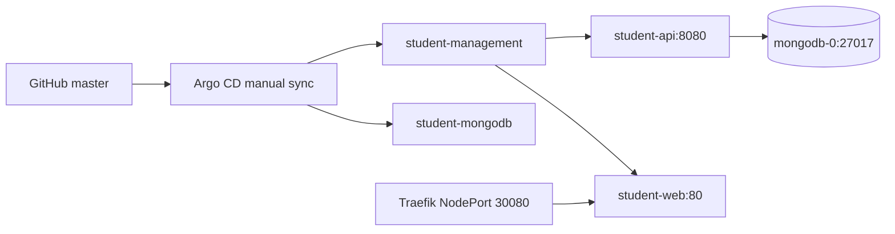

# RUNBOOK 04 — Argo CD, Traefik & Student Management Deployment

**Trạng thái:** `COMPLETED` cho GitOps manual sync và ứng dụng Student Management (frontend, backend, MongoDB).

## 1. Sơ đồ điều khiển



**Dữ liệu kiểm chứng:** `monitoring`, `student-management`, `student-mongodb` đều `Synced / Healthy` sau lần kiểm tra cuối của người vận hành ngày 29/10/2026.

## 2. Manifests và cấu hình hiện tại

| Thành phần | File GitOps | Runtime |
|---|---|---|
| Application frontend/backend | `gitops/applications/student-management.yaml` | ns `student`, manual Sync, prune/selfHeal disabled |
| App manifests | `kubernetes/apps/student-management/` | Deployments `student-api`, `student-web`; Services `api:8080`, `web:80` |
| Database | `gitops/applications/student-mongodb.yaml` | ns `student`; MongoDB StatefulSet/PVC |
| Monitoring chart | `gitops/applications/monitoring.yaml` | ns `monitoring` |
| Backend | `backend.yaml` | image `hoang4325/student-app-api:9` |
| Frontend | `frontend.yaml` | image `hoang4325/student-app-web:2` |
| App ingress | `ingress.yaml` | host `student.lab.test`, Traefik → Service `web` |

Backend `MONGO_URL` được lấy từ Kubernetes Secret `student-mongo-auth`, không commit URI/credentials vào Git. Backend health tại `/actuator/health`; Prometheus metrics tại `/actuator/prometheus`.

## 3. Kiểm tra hằng ngày (read-only)

```bash
kubectl -n argocd get applications
kubectl -n student get deploy,pods,svc,ingress -o wide
kubectl -n student get statefulset mongodb
kubectl -n student get pvc
kubectl -n traefik get pods,svc
kubectl get ingressclass
kubectl -n student rollout status deployment/student-api --timeout=120s
kubectl -n student rollout status deployment/student-web --timeout=120s
```

Lệnh HTTP theo tuyến nội bộ (trên node kết nối được worker):

```bash
curl -H 'Host: student.lab.test' http://10.20.0.11:30080/ -I
```

Nếu cần kiểm tra API mà không mở Ingress, mở port-forward trong terminal 1:

```bash
kubectl -n student port-forward svc/api 18081:8080
```

Terminal 2:

```bash
curl -fsS http://127.0.0.1:18081/actuator/health
curl -fsS http://127.0.0.1:18081/actuator/prometheus | head -20
```

Kết quả thực tế đã xác minh: `/actuator/health` trả HTTP 200 với `UP`, `/actuator/prometheus` có Micrometer metrics.

## 4. Quy trình thay đổi GitOps an toàn

1. Tạo branch ở GitHub, sửa *chỉ* các manifest liên quan; giữ cấu hình production khác nguyên vẹn.
2. `kubectl kustomize kubernetes/apps/student-management` và `kubectl kustomize kubernetes/databases/student-mongodb`.
3. Tạo PR, review `git diff`, đặc biệt `image:`, Secret references, PVC, Service selectors và nodeSelector.
4. Merge vào `master`.
5. Argo CD: chọn đúng Application → **Hard Refresh → Diff → Sync** (không Prune/Force/Replace).
6. Xác nhận `Synced/Healthy`; quan sát rollout và HTTP endpoints; lưu log build/tag/commit.

### Rollback khi bản image gây lỗi

Cách an toàn: revert commit thay `image:` trong GitHub, merge PR vào `master`, Argo CD Sync thủ công rồi `kubectl rollout status` và kiểm tra `/actuator/health`. Không đổi image thủ công và bỏ qua Git, trừ trường hợp ứng cứu cần ghi lại để đồng bộ sau.

## 5. Troubleshooting

**Argo CD OutOfSync:** so `Diff`, resource nào drift, ai quản lý. Trước đó từng gặp `monitoring OutOfSync` dù `Healthy` và về sau đã `Synced`; không sync mù khi Secret Grafana có thể khác giá trị trong Git.

**502/503:** kiểm tra Traefik Ingress, Service endpoints, Pod readiness, logs ứng dụng, connection MongoDB:

```bash
kubectl -n student describe ingress student-management
kubectl -n student get endpointslices
kubectl -n student describe pod -l app=student-api
kubectl -n student logs deployment/student-api --tail=100
kubectl -n student get pods -l app=mongodb
```

**Pod crash:** tra cứu `kubectl describe`, events, logs, resources và dữ liệu Secret tham chiếu; không in credentials.

## 6. Giới hạn đã biết

- Một replica backend/frontend/MongoDB; không có HA/automatic failover.
- App Ingress hiện thể hiện HTTP lab, chưa chứng minh TLS production.
- `Argo CD Synced` chứng minh desired/live state của Application, không thay thế kiểm thử nghiệp vụ tự động.

**Source:** `gitops/applications/*`, `kubernetes/apps/student-management/*`, `kubernetes/databases/student-mongodb/*`.
