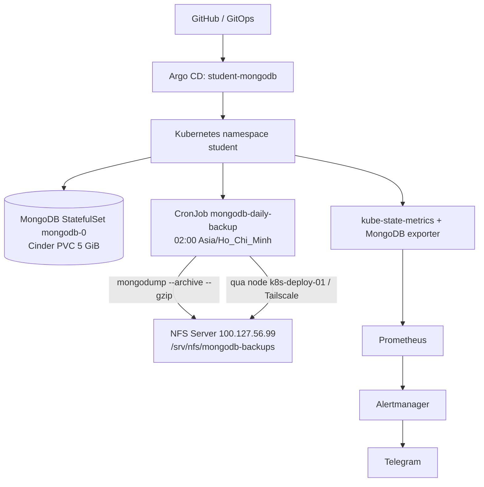

> **Đính chính vận hành cuối ngày 29/10/2026:** lịch backup hiện tại đã về **02:00**, đồng bộ với GitHub `master`; 09:00 là lịch kiểm thử đã hoàn thành. Xem mục Cập nhật sau nghiệm thu.

# RUNBOOK — MongoDB Backup, NFS Disaster Recovery & Monitoring

> **Dự án:** [Openstack-Cloud-Native-Private](https://github.com/hoang4325/Openstack-Cloud-Native-Private)  
> **Môi trường:** OpenStack AIO → Kubernetes → MongoDB/Student API → NFS ngoài OpenStack  
> **Ngày nghiệm thu:** 29/10/2026 (Asia/Ho_Chi_Minh)  
> **Trạng thái:** **COMPLETED — 10/10 bài kiểm thử theo phạm vi lab**  
> **Phạm vi:** Bằng chứng nghiệm thu 10 test case, lệnh vận hành/khôi phục thử nghiệm **không ghi đè database production**, troubleshooting, rủi ro còn lại.  
> **Vị trí đề xuất trong Git:** `docs/runbooks/mongodb-nfs-backup-dr.md`

## 1. Mục tiêu và nguyên tắc an toàn

Runbook phục vụ người trực vận hành để: (1) kiểm tra sao lưu tự động MongoDB vào NFS; (2) xác minh file và checksum; (3) khôi phục kiểm thử vào MongoDB tách biệt; (4) xử lý Job lỗi, NFS timeout, backup quá hạn và cảnh báo; (5) đối chiếu GitOps với trạng thái thực tế.

**Nguyên tắc bắt buộc:**

- Không chạy `mongorestore --drop` hay khôi phục vào `mongodb-0`/PVC production theo runbook thử nghiệm này.
- Không xóa/format OpenStack Cinder volumes, PVC `mongo-data-mongodb-0` hoặc thư mục backup thật để thử nghiệm.
- Không đưa MongoDB credentials, Telegram bot token hoặc thông tin xác thực OpenStack vào Git/log.
- CronJob tạo backup trên **NFS bên ngoài OpenStack**, không dùng Cinder volume làm kho backup đích.
- Sau khi thay đổi manifest, kiểm tra `git diff`, Argo CD Diff và chỉ Sync ứng dụng liên quan; tránh `Prune` không chủ đích.

## 2. Kiến trúc đang vận hành



| Hạng mục | Cấu hình thực tế |
|---|---|
| Kubernetes namespace | `student` |
| MongoDB | `StatefulSet/mongodb`, Pod `mongodb-0`, Service `mongodb`, port `27017` |
| MongoDB PVC | `mongo-data-mongodb-0`, StorageClass `cinder-lvm`, yêu cầu `5Gi` |
| CronJob | `mongodb-daily-backup`, `suspend: false`, `concurrencyPolicy: Forbid` |
| Lịch hiện tại trên cluster (cuối 29/10/2026) | `0 2 * * *`, timezone `Asia/Ho_Chi_Minh` |
| Worker backup | `k8s-deploy-01`, Tailscale `100.77.144.40` |
| NFS Server | Tailscale `100.127.56.99`, export `/srv/nfs/mongodb-backups` |
| Backup image | `mongo:5.0` |
| Secret nguồn | `student-mongo-auth` (chỉ tham chiếu Kubernetes Secret) |
| File đầu ra | `mongodb-<UTC timestamp>-<pod>.archive.gz` và `.archive.gz.sha256` |
| Chính sách | Gzip, SHA-256, bản tạm `.partial`, kiểm tra NFS + free space, retention khoảng 30 ngày |
| Monitoring | Prometheus, Grafana, kube-state-metrics, MongoDB exporter, Alertmanager/Telegram |

### Cập nhật sau nghiệm thu — lịch CronJob và trạng thái GitOps

**Lịch production hiện tại:** `schedule: "0 2 * * *"`, timezone `Asia/Ho_Chi_Minh`, `suspend: false`. Người vận hành xác nhận lại live CronJob lúc cuối buổi kiểm tra; cả ba Applications `monitoring`, `student-management`, `student-mongodb` đều `Synced / Healthy`.

**Lịch 09:00 là lịch THỬ NGHIỆM** ngày 29/10/2026: Job `mongodb-daily-backup-29887320` đã chạy lúc 09:00:00 +07, thành công lúc 09:00:08 +07; kết quả này vẫn là chứng cứ chính thức TC01/TC04. Sau kiểm thử, lịch vận hành đã trở về **02:00 hằng ngày**, trùng manifest GitHub `master`. `Last Schedule`/`Last Success` gắn với lần thử 09:00 không có nghĩa lần chạy 02:00 mới đã diễn ra.

**Các kiểm thử tương lai** cần kiểm tra lại dữ liệu backup sau lần chạy 02:00 đầu tiên. Việc App `Synced/Healthy` thể hiện GitOps đồng bộ, không thay thế xác minh từng lần backup.

## 3. Công việc đã hoàn thành và bằng chứng

| ID | Công việc | Bằng chứng thực tế | Kết quả |
|---|---|---|---|
| BK-01 | Kết nối Tailscale worker → NFS | `tailscale ping 100.127.56.99` trả pong qua `DERP(hkg)` | PASS (kết nối relay, chưa direct) |
| BK-02 | Kết nối NFS TCP 2049 | `nc -vz -w 5 100.127.56.99 2049` thành công | PASS |
| BK-03 | Mount NFSv4.1 / NFSv4.2 | `mount -t nfs` và `findmnt` xác nhận `nfs4`; đọc/ghi file thành công | PASS |
| BK-04 | Backup bằng Job thủ công | `mongodb-backup-test-1793236967` Completed, `BACKUP_OK`, 6 documents | PASS |
| BK-05 | Restore cách ly | Pod `mongodb-restore-lab`; `mongorestore --nsInclude=dev.student` khôi phục 6/6, lỗi 0; `countDocuments({})=6`; Pod đã xóa | PASS |
| BK-06 | CronJob tự động 09:00 | Job `mongodb-daily-backup-29887320`, Completed 1/1 sau 8 giây | PASS |
| BK-07 | Lưu archive trên NFS | File `mongodb-20261029T020003Z-mongodb-daily-backup-29887320-fn2cb.archive.gz`, 1.109 bytes | PASS |
| BK-08 | Kiểm tra tính toàn vẹn | `sha256sum -c ...archive.gz.sha256` trả `OK` | PASS |
| BK-09 | Retention khoảng 30 ngày | Job `mongodb-backup-retention-drill-1793240998` in `RETENTION_DELETED`, xóa archive giả 31 ngày + checksum; giữ file gần đây và file giả không checksum | **PASS — TC06/TC07** |
| BK-10 | Backup alert rules | `MongoDBBackupJobFailed` và `MongoDBBackupStale` cùng `inactive`, `health=ok`; drill tạo Job Failed và Stale gửi Telegram | **PASS — TC08/TC09**, xem giới hạn drill |
| BK-11 | Prometheus last success metric | `kube_cronjob_status_last_successful_time=1793239208` | PASS |
| OBS-01 | MongoDB exporter | Đã xác minh `mongodb_up=1` | PASS |
| OBS-02 | Spring Boot Actuator metrics | `/actuator/health`, `/actuator/prometheus` HTTP 200; ServiceMonitor + 2 rules | PASS |
| OBS-03 | Prometheus → Alertmanager → Telegram | Synthetic PrometheusRule `StudentAPITelegramSmokeTest`, backup failure Job và stale rule thử đều đã được báo nhận Telegram | PASS tuyến alert thử nghiệm |
| DR-01 | Restore archive CronJob 09:00 | `mongodb-20261029T020003Z-...fn2cb.archive.gz`; 6 docs, 0 failed, `countDocuments=6`, `time` 0.393 s, Pod xóa | **PASS — TC04** |
| DR-02 | Corruption detection | Thêm dữ liệu vào **bản sao tạm** của archive; `sha256sum` trả `FAILED` và script báo `PASS` | **PASS — TC05** |
| DR-03 | NFS security/capacity | NFS active, TCP 2049 LISTEN, export `/32`, file `600`, thư mục `770`, 3.5GiB trống, inode 19%, không có `.partial` | **PASS theo tiêu chí lab — TC10** |

**Dữ liệu restore đã kiểm chứng:** `dev.student` có 6 documents tại thời điểm backup. Đã restore **cả archive thủ công lẫn archive CronJob 09:00** vào MongoDB Pod cô lập, cả hai đều 6/6 documents, 0 lỗi. Đây là dữ liệu lab, không đại diện độ phức tạp production. Phép đo 0.393 giây là thời gian lệnh `kubectl exec ... mongorestore` của TC04, **không phải RTO** toàn dịch vụ.

## 4. Checklist vận hành hằng ngày

### 4.1. Trên `k8s-control-01`

```bash
# CronJob phải có lịch hiện tại 02:00, không suspend.
kubectl -n student get cronjob mongodb-daily-backup

# Xem lịch, thời điểm chạy và thời điểm thành công gần nhất.
kubectl -n student get cronjob mongodb-daily-backup \
  -o jsonpath='Schedule: {.spec.schedule}{"\n"}Suspend: {.spec.suspend}{"\n"}Last Schedule: {.status.lastScheduleTime}{"\n"}Last Success: {.status.lastSuccessfulTime}{"\n"}'

# Danh sách Job và Pod mới nhất.
kubectl -n student get jobs --sort-by=.metadata.creationTimestamp
kubectl -n student get pods -o wide | grep -E 'mongodb|backup'

# Xem log Job theo tên thực tế.
kubectl -n student logs job/mongodb-daily-backup-29887320

# Kiểm tra workload MongoDB và trạng thái GitOps.
kubectl -n student get statefulset mongodb
kubectl -n student get pvc mongo-data-mongodb-0
kubectl -n argocd get applications
```

Chỉ số quan trọng trong log: `BACKUP_OK`, `BACKUP_SIZE_BYTES`, và có dữ liệu được dump từ `dev.student`. `Complete` của Kubernetes Job và `BACKUP_OK` là hai tín hiệu bổ sung cho nhau.

### 4.2. Trên `nfs-server`

```bash
sudo ls -lht /srv/nfs/mongodb-backups/
sudo df -h /srv/nfs/mongodb-backups/

# Kiểm tra đúng checksum của archive cần xác minh.
cd /srv/nfs/mongodb-backups
sudo sha256sum -c \
  mongodb-20261029T020003Z-mongodb-daily-backup-29887320-fn2cb.archive.gz.sha256
```

Kết quả mong muốn: `<tên archive>: OK`. Không lưu trữ password hay file backup vào public repository.

### 4.3. Theo dõi bằng Prometheus

Trên một terminal của `k8s-control-01`:

```bash
kubectl -n monitoring port-forward \
  svc/monitoring-kube-prometheus-prometheus 9090:9090
```

Terminal SSH thứ hai:

```bash
curl -fsS http://127.0.0.1:9090/-/ready

curl -fsS 'http://127.0.0.1:9090/api/v1/rules?type=alert' |
  jq -r '.data.groups[].rules[] | select(.name=="MongoDBBackupJobFailed" or .name=="MongoDBBackupStale") | "\(.name) | state=\(.state) | health=\(.health)"'

curl -fsSG 'http://127.0.0.1:9090/api/v1/query' \
  --data-urlencode 'query=kube_cronjob_status_last_successful_time{namespace="student",cronjob="mongodb-daily-backup"}' |
  jq -r '.data.result[] | "\(.metric.cronjob) | \(.value[1])"'
```

`health=ok` nghĩa rule được đánh giá bình thường, **không đảm bảo** tín hiệu lỗi sẽ kích hoạt trong mọi sự cố. `inactive` là bình thường khi không có điều kiện cảnh báo.

## 5. Chạy backup thủ công khi cần

> Chỉ thực hiện khi xác nhận không có Job backup đang chạy và NFS còn dung lượng. Không tạo đồng thời nhiều Job thủ công vì `concurrencyPolicy: Forbid` không bắt buộc áp dụng cho Job tạo tách rời bằng `kubectl create job --from=cronjob`.

```bash
kubectl -n student get jobs --sort-by=.metadata.creationTimestamp

JOB="mongodb-backup-manual-$(date +%s)"
kubectl -n student create job --from=cronjob/mongodb-daily-backup "$JOB"
kubectl -n student get pods -l batch.kubernetes.io/job-name="$JOB" -o wide
kubectl -n student logs "job/$JOB" -f
```

Tiêu chí thành công: Job `Complete`; log có `BACKUP_OK`; file `.archive.gz` và `.sha256` có trên NFS; `sha256sum -c` trả `OK`.

## 6. Quy trình restore kiểm thử an toàn

**Mục đích:** Chứng minh archive có thể phục hồi dữ liệu vào MongoDB tạm thời mà không chạm tới MongoDB đang chạy. Thực hiện trên `k8s-control-01`.

### 6.1. Tạo Pod MongoDB thử nghiệm

```bash
cat <<'EOF_POD' | kubectl apply -f -
apiVersion: v1
kind: Pod
metadata:
  name: mongodb-restore-lab
  namespace: student
spec:
  nodeSelector:
    kubernetes.io/hostname: k8s-deploy-01
  restartPolicy: Never
  automountServiceAccountToken: false
  containers:
    - name: mongo
      image: mongo:5.0
      args: ["mongod", "--bind_ip", "127.0.0.1"]
      resources:
        requests: {cpu: 100m, memory: 256Mi}
        limits: {cpu: "1", memory: 1Gi}
      volumeMounts:
        - {name: data, mountPath: /data/db}
        - {name: backup, mountPath: /backup, readOnly: true}
  volumes:
    - name: data
      emptyDir: {}
    - name: backup
      nfs:
        server: 100.127.56.99
        path: /srv/nfs/mongodb-backups
        readOnly: true
EOF_POD

kubectl -n student wait --for=condition=Ready pod/mongodb-restore-lab --timeout=180s
```

### 6.2. Restore đúng collection vào Pod tạm

```bash
# Archive từ CronJob tự động 09:00 — đã restore thành công ở TC04.
FILE="/backup/mongodb-20261029T020003Z-mongodb-daily-backup-29887320-fn2cb.archive.gz"

kubectl -n student exec mongodb-restore-lab -c mongo -- \
  mongorestore --host 127.0.0.1:27017 \
  --gzip --archive="$FILE" --nsInclude="dev.student"

kubectl -n student exec mongodb-restore-lab -c mongo -- \
  mongo --quiet --host 127.0.0.1 \
  --eval 'db.getSiblingDB("dev").student.countDocuments({})'
```

**Kết quả TC04 thực đo:** `6 document(s) restored successfully`, `0 document(s) failed`, `countDocuments({})=6`, `real 0m0.393s`. Pod thử nghiệm đã được xóa sau kiểm tra.

Thay `FILE` bằng archive khác khi kiểm thử bản backup mới. Lệnh chỉ restore `dev.student`; không khôi phục `admin.system.users` vào Pod tạm. Trước khi restore vào môi trường production sau thảm họa, cần có change plan riêng để xử lý các database/collection khác, tài khoản, indexes và ứng dụng phụ thuộc; runbook này không cho phép ghi đè production.

### 6.3. Dọn tài nguyên tạm

```bash
kubectl -n student delete pod mongodb-restore-lab
```

`emptyDir` biến mất theo Pod; file trên NFS không bị xóa.

## 7. Runbook xử lý sự cố

### 7.1. Backup Job `Failed`, `Pending` hoặc `ContainerCreating`

```bash
kubectl -n student get jobs --sort-by=.metadata.creationTimestamp
kubectl -n student get pods -o wide | grep backup
kubectl -n student describe pod <TEN_POD_BACKUP>
kubectl -n student get events --sort-by=.lastTimestamp | tail -30
kubectl -n student logs job/<TEN_JOB_BACKUP> --all-containers=true --prefix=true
```

- `FailedMount` / timeout: kiểm tra NFS Server, Tailscale, TCP/2049; **không vội sửa PVC MongoDB**.
- Lỗi xác thực MongoDB: kiểm tra tên và sự tồn tại của Secret `student-mongo-auth` cùng các key `username`, `password`; không in Secret ra terminal hoặc log.
- `ERROR: /backup khong phai NFS mount`: không được cho Job fallback sang local disk; xử lý mount trước.
- `ERROR: NFS con duoi 256 MiB`: kiểm tra dung lượng NFS, lên kế hoạch tăng chỗ trống; không xóa archive tùy tiện.
- Dump lỗi/chạy quá `activeDeadlineSeconds: 1800`: kiểm tra log, tải MongoDB và đường truyền NFS.

### 7.2. Kiểm tra NFS từ `k8s-deploy-01`

```bash
tailscale ping 100.127.56.99
nc -vz -w 5 100.127.56.99 2049
sudo mkdir -p /mnt/nfs-test
sudo timeout 40s mount -v -t nfs \
  -o nfsvers=4.1,proto=tcp,port=2049 \
  100.127.56.99:/srv/nfs/mongodb-backups /mnt/nfs-test
findmnt /mnt/nfs-test
sudo umount /mnt/nfs-test
```

Trên `nfs-server` nếu vẫn lỗi:

```bash
sudo systemctl status nfs-kernel-server --no-pager
sudo exportfs -v
sudo ss -lnt | grep ':2049'
df -h /srv/nfs/mongodb-backups
```

Trong kiểm thử ngày 29/10/2026, kết nối Tailscale dùng `DERP(hkg)` và chưa thiết lập direct; có thể ảnh hưởng độ ổn định/hiệu năng dù các lần mount và backup đã thành công.

### 7.3. Không thấy Prometheus Alert Rules

```bash
kubectl -n student get prometheusrule mongodb-alerts -o yaml
kubectl -n monitoring get svc | grep prometheus
kubectl -n argocd get applications
```

Mở port-forward rồi query `/api/v1/rules?type=alert` như mục 4.3. Nếu `curl: (7) Failed to connect to 127.0.0.1:9090`, thường do **port-forward chưa mở/đã kết thúc**, chưa thể kết luận Prometheus lỗi.

### 7.4. `MongoDBBackupStale` hoặc mất lịch

```bash
kubectl -n student get cronjob mongodb-daily-backup \
  -o jsonpath='Schedule={.spec.schedule}{"\n"}Suspend={.spec.suspend}{"\n"}LastSchedule={.status.lastScheduleTime}{"\n"}LastSuccess={.status.lastSuccessfulTime}{"\n"}'
kubectl -n student get jobs --sort-by=.metadata.creationTimestamp
```

So sánh `Last Success` với giờ vận hành, Job và file mới nhất trên NFS. Alert hiện dùng metric thời điểm thành công của CronJob, không đọc file trực tiếp trên NFS. Nếu Job báo `Complete` nhưng archive/checksum không hợp lệ, coi là sự cố cần kiểm tra riêng.

### 7.5. Checksum không khớp

- **Không restore** archive bị lỗi checksum.
- Giữ nguyên file để phân tích, đối chiếu file cũ còn hợp lệ; kiểm tra disk/NFS/network.
- Khởi tạo bản backup mới nếu an toàn, sau đó xác minh checksum và restore vào môi trường thử nghiệm.

## 8. Tham chiếu Prometheus / Telegram

| Rule | Mục đích | Tình trạng kiểm chứng |
|---|---|---|
| `MongoDBBackupJobFailed` | Cảnh báo Job backup thất bại trong 24 giờ gần đây | **TC08 PASS:** giả lập Job Failed, `kube_job_failed=1`, Prometheus `pending` khi chụp, người vận hành xác nhận Telegram nhận alert |
| `MongoDBBackupStale` | Cảnh báo backup thành công gần nhất quá khoảng 26 giờ (hoặc chưa có lần thành công sau lần lên lịch) | Rule chính thức `inactive/ok`, metric last success có dữ liệu; **TC09 PASS cho rule drill** `MongoDBBackupStaleDrill` dùng thời gian giả lập, người vận hành xác nhận Telegram nhận cảnh báo |
| `MongoDBDown`, `MongoDBExporterDown` | Khả dụng DB/Exporter | Rules đã được nạp trong lab |
| `MongoDBPodRestarting`, `MongoDBPVCUsageHigh` | Restart/PVC gần đầy | Rules đã được nạp; cần xác minh tín hiệu thực tế từng loại |
| `StudentAPIDown`, `StudentAPIHigh5xx` | Khả dụng và lỗi HTTP backend | Nạp thành công: `inactive`, `health=ok` |

**Đã kiểm thử tuyến end-to-end:** Prometheus test rule và Job backup giả lập lỗi đều dẫn đến Telegram. TC09 sử dụng **PrometheusRule riêng tên `MongoDBBackupStaleDrill`** cộng dịch thời gian trong PromQL; vì vậy xác nhận tuyến nhận cảnh báo và điều kiện giả lập, **không phải test một lần backup production bị bỏ lỡ thật**. Truy vấn ngay sau tạo rule chưa trả kết quả; bằng chứng cuối cho TC09 là người vận hành xác nhận Telegram nhận tin, chưa lưu trạng thái `firing` từ Prometheus.

## 9. GitOps: nơi lưu cấu hình và quy trình thay đổi

```text
kubernetes/databases/student-mongodb/
├── mongodb.yaml
├── mongodb-backup-cronjob.yaml
├── mongodb-alerts.yaml
├── mongodb-exporter.yaml
├── mongodb-telegram-alertmanagerconfig.yaml
└── kustomization.yaml

kubernetes/apps/student-management/
├── backend.yaml
├── backend-servicemonitor.yaml
├── backend-alerts.yaml
└── kustomization.yaml

gitops/applications/student-mongodb.yaml
```

Ứng dụng Argo CD `student-mongodb` quản lý CronJob và MongoDB PrometheusRule. Khi sửa, tạo branch và PR, kiểm tra manifest, merge, Hard Refresh → Diff → Sync **riêng** application này; nếu bất kỳ ứng dụng nào `OutOfSync`, xem chính xác Diff trước khi Sync. Tại thời điểm chốt nghiệm thu, 3/3 Applications `Synced/Healthy`.

```bash
# Trên máy đã clone repository, ở thư mục gốc:
kubectl kustomize kubernetes/databases/student-mongodb \
  > /tmp/student-mongodb-rendered.yaml

# Trên k8s-control-01 sau khi Sync:
kubectl -n student get cronjob mongodb-daily-backup
kubectl -n student get prometheusrule mongodb-alerts
kubectl -n argocd get applications
```

**GitOps consistency đã kiểm tra:** Live CronJob và manifest `master` đều `schedule: "0 2 * * *"`; `student-mongodb` `Synced/Healthy`. Đối với lần đổi lịch tiếp theo, thay đổi qua PR và Argo CD manual Sync.

## 10. Giới hạn, rủi ro và công việc còn lại

| Mục | Trạng thái / hành động |
|---|---|
| Backup/restore | **PASS:** 6/6 documents từ cả backup thủ công và backup tự động vào Pod tách biệt; chưa diễn tập full-service recovery hoặc mọi database và quyền truy cập ứng dụng |
| Kiểm tra archive tự động | **PASS:** SHA-256 `OK` và restore trực tiếp archive 09:00 thành công 6/6 docs |
| Retention | **PASS TC06/TC07:** archive giả cũ 31 ngày + `.sha256` bị xóa; archive mới và orphan không checksum được giữ, lệnh dọn test đã chạy |
| Alert backup | **PASS TC08/TC09 theo drill:** Job Failed phát metric `1` và gửi Telegram; rule Stale giả lập gửi Telegram. Chưa thử bỏ lỡ lịch production thật |
| GitOps schedule | **PASS:** đã đưa live về 02:00, khớp manifest `master`; 3/3 Argo CD Applications `Synced/Healthy` |
| NFS availability | NFS server trên máy riêng, filesystem backup chung phân vùng `/` 8.1GiB (3.5GiB còn trống), NFS `2049` listen `0.0.0.0` và `[::]`; cần firewall chặn mạng không cần thiết. Tailscale dùng DERP relay, không phải kết nối direct |
| Bảo mật | Archive chứa `admin.system.users` và dữ liệu DB, quyền file `0600`; thư mục `0770`; export giới hạn `100.77.144.40/32` với `root_squash` nhưng NFS `sec=sys`, root client có thể bị ánh xạ sang owner `nobody`. Chưa xác minh firewall/ACL từ các interface khác, mã hóa at-rest, backup bất biến hoặc offsite |
| Tính nhất quán | Dùng `mongodump` từ MongoDB đang chạy; chưa xác minh mức nhất quán/ảnh chụp cho nhiều ghi đồng thời; không tuyên bố backup point-in-time cho workload ghi lớn |
| RPO / RTO | Backup lên lịch mỗi 24 giờ khi hệ thống khả dụng; **chưa thiết lập/đo RPO/RTO chính thức** |
| Monitoring app | **Synced/Healthy** tại lần kiểm tra cuối; đã từng có thời điểm OutOfSync nhưng hiện đã được đồng bộ |

## 11. Tiêu chí đóng incident / nghiệm thu

- [x] Kết nối Tailscale + TCP 2049 + NFS mount hoạt động.
- [x] MongoDB Job chạy thành công với `BACKUP_OK`.
- [x] File archive và SHA-256 đã được ghi vào NFS Server.
- [x] Restore tách biệt đủ 6/6 documents, không lỗi, Pod thử đã dọn.
- [x] Lần chạy tự động 09:00 thành công (`Last Success=2026-10-29T02:00:08Z`).
- [x] Checksum archive tự động là `OK`.
- [x] Prometheus nạp hai Backup Rules (`health=ok`) và có metric last success.
- [x] Retention 30 ngày đã hiện diện và đã kiểm thử bằng file giả lập (TC06/TC07).
- [x] Restore lại archive tự động 09:00, kiểm tra đủ 6/6 documents (TC04).
- [x] Phát hiện bản sao archive bị thay đổi qua checksum (TC05).
- [x] Diễn tập Job Failed → Telegram (TC08) và Stale Drill → Telegram (TC09).
- [x] Kiểm tra dung lượng, inode, NFS service, TCP 2049, export ACL, file mode và `.partial` (TC10).
- [x] **GitOps cuối cùng:** đã đưa live CronJob về 02:00, khớp Git `master`; 3/3 Argo CD Applications `Synced/Healthy`.
- [ ] **Nâng cấp về sau:** DR drill định kỳ, mã hóa/bất biến/offsite, firewall và đánh giá bảo vệ dữ liệu đầy đủ, RPO/RTO thực đo, diễn tập khôi phục toàn dịch vụ.

---

## 12. Final Test Acceptance Report — 29/10/2026

**Trạng thái nghiệm thu: `COMPLETED` cho phạm vi lab; 10/10 test case PASS dựa trên log/bằng chứng người vận hành cung cấp.** Không đồng nghĩa hệ thống đạt chuẩn production, HA, có RPO/RTO cam kết hoặc chống ransomware.

| Test ID | Bài kiểm thử / thao tác | Bằng chứng thực tế / Actual Result | Status |
|---|---|---|---|
| **TC01** | CronJob sao lưu tự động 09:00 | `mongodb-daily-backup-29887320` `Complete 1/1`, 8s; `Last Schedule=2026-10-29T02:00:00Z`, `Last Success=...02:00:08Z`; log `BACKUP_OK`, 6 docs | **PASS** |
| **TC02** | Checksum archive tự động | NFS Server `sha256sum -c mongodb-20261029T020003Z-...fn2cb.archive.gz.sha256` trả `OK`, đã xác minh lại sau các drill | **PASS** |
| **TC03** | Restore từ archive thủ công | `mongodb-backup-test-1793236967` restore `dev.student` 6 docs, 0 failures; `countDocuments({})=6` | **PASS** |
| **TC04** | Restore từ archive tự động 09:00 | `mongorestore --archive=/backup/mongodb-20261029T020003Z-...fn2cb.archive.gz --nsInclude=dev.student` trả 6 docs, 0 failures, đếm 6; thời gian lệnh `real 0m0.393s`, Pod đã xóa | **PASS** |
| **TC05** | Phát hiện archive hỏng | Tạo bản sao trong `/tmp`, nối `SIMULATED_CORRUPTION`; `sha256sum` trả `FAILED` và script báo `PASS`; bản gốc trên NFS không bị sửa | **PASS** |
| **TC06** | Retention xóa archive cũ và checksum | File test `mongodb-retention-drill-old.archive.gz` (mtime 31 ngày), có checksum; Job `mongodb-backup-retention-drill-1793240998` log `RETENTION_DELETED`, cả archive + checksum không còn | **PASS** |
| **TC07** | Retention giữ archive hợp lệ mới và orphan | Kiểm tra `recent` còn, `orphan` (không `.sha256`) vẫn còn sau Job; file drill đã được dọn theo lệnh | **PASS** |
| **TC08** | Backup Job Failed → Telegram | Job drill `mongodb-daily-backup-drill-1793241212` `Failed`; `kube_job_failed{condition="true"}=1`; alert Prometheus `pending` khi truy vấn, người vận hành xác nhận đã nhận Telegram sau đó | **PASS** |
| **TC09** | Backup Stale simulated → Telegram | `kube_cronjob_spec_suspend=0`; tạo `PrometheusRule/mongodb-backup-stale-drill`, cộng thời gian giả lập trong PromQL; người vận hành xác nhận nhận tin Telegram. API rule query ban đầu chưa trả kết quả; không có log `firing` được cung cấp | **PASS (mô phỏng cảnh báo; độ bao phủ giới hạn)** |
| **TC10** | NFS security/capacity & nguyên vẹn | `df`: 8.1GiB tổng/4.2GiB dùng/3.5GiB trống (56%); inode 19%; service active; NFS port 2049 LISTEN IPv4/IPv6; export `100.77.144.40/32` `rw,root_squash`; dir `770`, archive `600`; không `.partial`; checksum gốc vẫn `OK` | **PASS theo tiêu chí lab** |

### 12.1. Lệnh tạo bằng chứng nhanh sau bàn giao

```bash
# Trên k8s-control-01:
kubectl -n student get cronjob mongodb-daily-backup
kubectl -n student get jobs --sort-by=.metadata.creationTimestamp
kubectl -n student get prometheusrule mongodb-alerts
kubectl -n argocd get applications

# Trên nfs-server:
sudo df -h /srv/nfs/mongodb-backups
sudo exportfs -v
sudo ss -lntp | grep ':2049'
sudo find /srv/nfs/mongodb-backups -maxdepth 1 -type f -name '*.partial' -print
cd /srv/nfs/mongodb-backups
sudo sha256sum -c mongodb-20261029T020003Z-mongodb-daily-backup-29887320-fn2cb.archive.gz.sha256
```

### 12.2. Các giới hạn của test suite

1. **TC09:** Telegram xác nhận thông báo, nhưng truy vấn Prometheus ngay sau khi tạo rule chưa trả kết quả. Không đánh đồng Stale drill với thử nghiệm backup production bị bỏ lỡ thật.
2. **TC06/07:** Kiểm chứng logic với file giả lập 31 ngày và file mới, không chứng minh chính sách dữ liệu khi dung lượng đầy, lỗi xóa hoặc chạy chồng lệnh.
3. **TC03/04:** Restore đúng một collection với 6 documents; `mongodump` archive có thể chứa nhiều namespace hơn. Chưa test toàn bộ hệ thống, tải lớn hoặc MongoDB failover.
4. **TC10:** `root_squash` cùng quyền `nobody` và NFS AUTH_SYS chưa phải bảo vệ chống sửa/xóa bởi client được cho phép; kiểm tra firewall và giải pháp bản sao bất biến/offsite nếu có nhu cầu thực tế.
5. **GitOps consistency đã xử lý:** CronJob live được đưa lại `0 2 * * *`, trùng `master`; các Applications `Synced/Healthy`. Lịch 09:00 chỉ là lịch kiểm thử và bằng chứng archive đã được giữ.

### 12.3. Hành động chuyển giao (ưu tiên)

- **Completed — GitOps consistency:** Cluster và `master` cùng lịch 02:00; 3/3 Argo Applications Synced/Healthy. Thay đổi sau này qua PR và manual Sync.
- **P2 — Backup hygiene:** Giám sát dung lượng filesystem `/`; cân nhắc backup disk riêng; đặt cảnh báo capacity thực tế và kiểm thử phục hồi định kỳ theo dữ liệu phát triển.
- **P2 — Access:** Kiểm tra firewall cho NFS TCP 2049 (đang listen mọi interface), giới hạn đường truy cập, xem xét backup immutable/mã hóa/offsite.
- **P3 — SRE:** Đo RPO/RTO ở mức ứng dụng, lưu bằng chứng thực nghiệm từng lần và bổ sung runbook full recovery được phê duyệt.

---

**Kết luận nghiệm thu:** MongoDB backup tự động qua NFS/Tailscale, integrity validation, isolated restore và alert drills đã **hoàn thành theo phạm vi private cloud lab**. Đây là **bằng chứng vận hành** chứ không phải xác nhận production readiness hoặc khả năng high availability.
